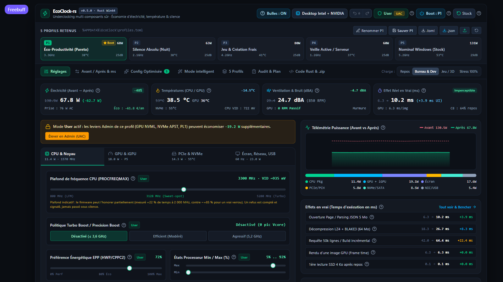

# EcoClock-rs Web

Configurateur web (React + Vite) pour un utilitaire Windows d'underclocking écrit en Rust.
L'interface construit, compare et exporte des profils d'alimentation sobres ; le crate Rust
embarqué les applique via les API Windows documentées, sans pilote noyau.

**Feuille de route** : [ROADMAP.md](ROADMAP.md) — licence, intégration continue, releases, puis le reste.



## Fonctionnalités

- **5 profils** (éco-productivité, silence, jeu, veille active, stock) avec comparateur avant/après.
- **Export `profiles.toml`** au schéma du crate Rust (`ProfileStore`), avec migration des anciens fichiers à booléens.
- **Script `.ps1` autonome** : applique le profil, sauvegarde le plan d'alimentation actif et sait le restaurer (`-Restore`).
- **Audit de sûreté** avant application, matrice adaptative sur 7 situations, journal des appels Win32.
- **Détection de capacités** : un réglage refusé par Windows est compté et annoncé, jamais ignoré en silence.

## Mesuré ou modélisé

L'interface affiche des projections, pas des relevés. Ce tableau dit ce qui vient d'un capteur et ce qui sort du modèle.

| Grandeur affichée | Origine | Comment |
|---|---|---|
| Températures CPU/GPU, point chaud, RPM, dBA système | **modélisé** | `src/engine/physics.ts` : TDP, charge, résidence C-states, ambiance 22 °C |
| Puissance paquet, consommation murale, €/an, CO₂ | **modélisé** | rendement PSU, tarif et mix paramétrables |
| Temps d'exécution avant/après (ms) | **modélisé** | modèle de charge, pas un benchmark exécuté |
| Valeurs écrites puis relues dans le plan d'alimentation | **mesuré** | `powrprof` côté Rust, relecture après écriture |
| Effet du plafond 55 % et de `PROCFREQMAX` | **mesuré sur ce poste** | 775,5 → 1 088,5 ms (+40,4 %, 1 thread) ; 922,5 → 1 123,5 ms (+21,8 %) |
| Température réelle du CPU | **indisponible** | `MSAcpi_ThermalZoneTemperature` absent sur ce poste |

Le crate Rust lit les capteurs quand ils existent ; le configurateur web, lui, ne lit rien : il calcule.

## Démarrage

```bash
npm ci
npm run dev      # serveur de développement Vite
npm run build    # bundle single-file dans dist/
```

## Livrable Rust

L'onglet « Code Rust & .zip » assemble un crate complet (21 fichiers) téléchargeable. Il n'existe
pas sur le disque : il est généré depuis `src/data/rustProject.ts`. La garde :

```bash
npm run check:rust   # extrait le crate puis cargo check --all-targets
```

## Tests

| Commande | Résultat |
|---|---|
| `npx vitest run` | 43/43 |
| `npm run check:rust -- --keep`, puis `cargo test` dans `.check-rust/` | 10/10 |
| `npx tsc --noEmit` | 0 erreur |

## Sécurité

- Aucun pilote noyau, aucun service : uniquement les API Windows documentées (`powrprof`, `ChangeDisplaySettingsExW`) et NVML pour NVIDIA.
- `RollbackGuard` restaure le profil de départ à la sortie si demandé.
- Le script `.ps1` exporte le plan actif (`baseline-scheme.pow`) avant toute modification et vérifie sa restauration.

## Limites connues

- Windows uniquement.
- `PROCFREQMAX` est un plafond **partiel** sur AMD : mesuré +21,8 % de temps mono-thread à 2 000 MHz, contre ~+85 % pour un verrou dur.
- La température CPU n'est pas toujours exposée (`MSAcpi_ThermalZoneTemperature` absent sur certains postes).

## Structure

```
src/engine/                  physique, optimisation Pareto, validation, tests
src/data/rustProject.ts      crate Rust embarqué (21 fichiers)
src/utils/windowsScript.ts   générateur du script .ps1
PLAN-ACTIONS.md              état du projet, décisions et pièges connus
```

## Licence

[MIT](LICENSE) — Copyright (c) 2026 Bisse Studio.
